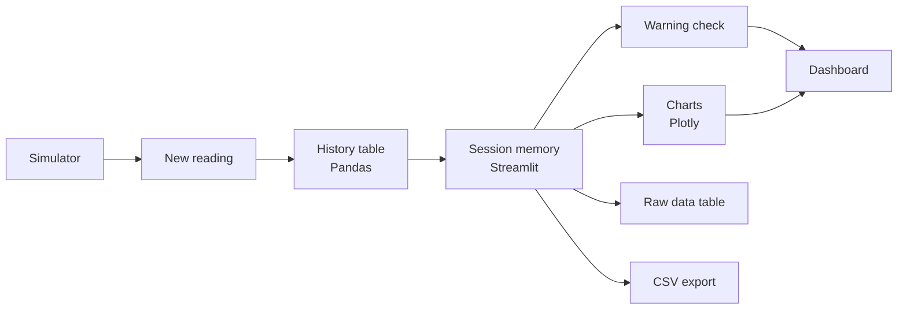

# MarineSense

**A dashboard that shows how a ship moves at sea, using simulated sensor data.**


MarineSense is a small Python app that runs in your web browser. It pretends to be a set of sensors on a ship, collects their readings, draws charts of them, and shows a warning when the ship rolls or shakes too much.

> [!IMPORTANT]
> All data in MarineSense is **simulated**. The app is not connected to any real ship or sensor. Do not use it for navigation, cargo, engineering, or safety decisions.

<table>
  <tr>
    <td width="50%">
      
    </td>
    <td width="50%">
      
    </td>
  </tr>
  <tr>
    <td width="50%">
      
    </td>
    <td width="50%">
      
    </td>
  </tr>
</table>

---

## Table of Contents

- [What it does](#what-it-does)
- [Key terms](#key-terms)
- [Getting started](#getting-started)
  - [Prerequisites](#prerequisites)
  - [Installation](#installation)
  - [Running the app](#running-the-app)
- [Usage](#usage)
- [Configuration](#configuration)
- [How it works](#how-it-works)
- [Data format](#data-format)
- [Project structure](#project-structure)
- [Tech stack](#tech-stack)
- [Limitations](#limitations)
- [Roadmap](#roadmap)
- [Contributing](#contributing)
- [License](#license)
- [Disclaimer](#disclaimer)

---

## What it does

| Feature | Description |
|---|---|
| **Simulated sensors** | Generates realistic-looking, smoothly changing motion data for a fictional ship. |
| **History** | Starts with 60 readings (one per minute) and keeps up to the latest 180. |
| **Live mode** | Adds a new reading automatically about every 3 seconds. |
| **Manual mode** | Adds a single new reading when you click a button. |
| **Ship selection** | Lets you switch between several fictional ships. |
| **Key numbers** | Shows the latest roll, pitch, heave, and acceleration at a glance. |
| **Charts** | Interactive charts that show how values change over time. |
| **Warnings** | Alerts you when roll or acceleration goes above a limit you choose. |
| **Raw data** | Shows every reading in a table. |
| **CSV export** | Downloads all readings as a spreadsheet-friendly file. |

## Key terms

If you are new to ship motion, these are the values the app tracks:

| Term | Plain meaning | Unit |
|---|---|---|
| **Roll** | The ship tilting from side to side (left/right). | degrees (°) |
| **Pitch** | The ship tilting forwards and backwards (nose up/down). | degrees (°) |
| **Heave** | The ship moving straight up and down with the waves. | metres (m) |
| **Acceleration** | How strongly the ship is being pushed or shaken. | m/s² |
| **Temperature** | A simulated temperature reading. | °C |
| **Threshold** | The limit above which the app shows a warning. | — |

## Getting started

### Prerequisites

- [Python](https://www.python.org/downloads/) **3.10 or newer**
- [Git](https://git-scm.com/downloads) (optional — you can also download the ZIP)
- An internet connection for the first installation

Check your Python version:

```bash
python --version
```

### Installation

**1. Get the code**

```bash
git clone https://github.com/Starley-iggy/MarineSense.git
cd MarineSense
```

Or click **Code → Download ZIP** on GitHub and unzip it.

**2. Create a virtual environment**

A virtual environment keeps this project's packages separate from the rest of your computer.

<details>
<summary>Windows (PowerShell)</summary>

```powershell
py -m venv .venv
.\.venv\Scripts\Activate.ps1
```

</details>

<details>
<summary>macOS / Linux</summary>

```bash
python3 -m venv .venv
source .venv/bin/activate
```

</details>

**3. Install the dependencies**

```bash
python -m pip install --upgrade pip
python -m pip install -r requirements.txt
```

### Running the app

```bash
python -m streamlit run app.py
```

Your browser should open automatically. If it doesn't, go to the address shown in the terminal — usually <http://localhost:8501>.

> [!TIP]
> **Windows shortcut:** double-click `run_dashboard.bat`. It creates the virtual environment if needed, installs everything, and starts the app.

To stop the app, press `Ctrl + C` in the terminal.

## Usage

1. **Pick a ship** in the left sidebar.
2. **Read the key numbers** at the top: roll, pitch, heave, and acceleration.
3. **Set your limits** for roll and acceleration with the sliders.
4. Click **Generate new reading** to add one new measurement.
5. Turn on **Live simulation** to add a new reading every ~3 seconds.
6. **Explore the charts** — hover to see exact values, drag to zoom.
7. Open the **raw data** section to see every reading.
8. Click the **CSV export** button to download the data.

The status at the top tells you at a glance whether everything is within your limits (**nominal**) or not (**warning**). Any warnings are listed in a table with the value, the rule that was broken, and a suggested check.

## Configuration

Warning limits are set in the sidebar while the app runs. No config files are needed.

| Setting | Default | Range | Warning when… |
|---|---|---|---|
| Roll threshold | 12° | 5° – 18° | the roll (left or right) is **at or above** the limit |
| Acceleration threshold | 1.5 m/s² | 0.5 – 2.5 m/s² | acceleration is **at or above** the limit |

Roll is checked in both directions: a tilt of −13° counts the same as +13°.

```text
roll warning          = |roll| >= roll threshold
acceleration warning  = acceleration >= acceleration threshold
status                = WARNING if either rule is true, otherwise NOMINAL
```

> [!NOTE]
> These limits are example values for the demo. They are **not** real maritime safety limits.

## How it works



1. **Generate** – The simulator creates a new reading based on the previous one, so values change smoothly instead of jumping randomly. Occasionally it adds a bigger spike so you can see the warnings in action.
2. **Store** – Readings are kept in a table (Pandas DataFrame). Streamlit's session memory keeps that table alive while you click around.
3. **Check** – The newest roll and acceleration values are compared with your limits.
4. **Show** – The dashboard displays the status, key numbers, warnings, and charts.
5. **Export** – You can download all stored readings as a CSV file.

## Data format

Each reading has these fields:

| Field | Type | Unit | Description |
|---|---|---|---|
| `timestamp` | datetime | local time | When the reading was taken |
| `roll` | float | ° | Side-to-side tilt |
| `pitch` | float | ° | Front-to-back tilt |
| `heave` | float | m | Up-and-down movement |
| `accel` | float | m/s² | Acceleration |
| `temperature` | float | °C | Simulated temperature |

The exported file is called `marinesense_sensor_history.csv`.

## Project structure

```text
MarineSense/
├── app.py                 # The whole app: simulator, data handling, warnings and dashboard
├── requirements.txt       # Python packages the app needs
├── run_dashboard.bat      # One-click start script for Windows
├── PRESENTATION_NOTES.md  # Notes for presenting the project
└── README.md              # This file
```

## Tech stack

| Tool | What it's used for |
|---|---|
| [Python](https://www.python.org/) | App logic and data simulation |
| [Streamlit](https://streamlit.io/) | The web dashboard and controls |
| [Pandas](https://pandas.pydata.org/) | Storing and organising readings, CSV export |
| [Plotly](https://plotly.com/python/) | Interactive charts |
| CSS | Custom dashboard styling |

Minimum versions (from `requirements.txt`):

```text
streamlit >= 1.36
pandas    >= 2.0
plotly    >= 5.20
```

## Limitations

MarineSense is a **prototype**, not a production system.

- **Fake input** – no real sensors, ship network, API, or message broker.
- **No database** – data is lost when you close the app.
- **Simple rules** – only roll and acceleration trigger warnings.
- **Only the latest reading is checked** – no trends, durations, or rate-of-change analysis.
- **No input validation** – missing, late, duplicate, or broken data is not handled.
- **No login** – no user accounts or access control.
- **Not deployment-ready** – no monitoring, backups, or hardening.
- **Not certified** – not approved for any safety-critical use.

## Roadmap

Ideas for future versions. **None of these are built yet.**

- [ ] Connect to a real, documented sensor feed or API
- [ ] Support a messaging protocol such as MQTT
- [ ] Save data in SQLite or a time-series database
- [ ] Split `app.py` into separate modules (simulation, ingestion, monitoring, UI)
- [ ] Validate incoming data (missing, stale, duplicate, impossible values)
- [ ] Smarter warnings: hysteresis, duration checks, event history
- [ ] Unit and integration tests
- [ ] Logging and health checks
- [ ] Authentication and access control
- [ ] Packaged, repeatable deployment

Before connecting to real ship systems, the equipment, data formats, protocols, units, update rates, data ownership, and operational requirements would all need to be clarified.

## Contributing

Suggestions and improvements are welcome.

1. Fork the repository.
2. Create a branch: `git checkout -b feature/my-change`
3. Commit your changes: `git commit -m "Describe your change"`
4. Push the branch: `git push origin feature/my-change`
5. Open a pull request.

For bugs or ideas, please [open an issue](https://github.com/Starley-iggy/MarineSense/issues).

## License

This project does not yet include a license. Until one is added, all rights are reserved by the author.

## Disclaimer

MarineSense is an educational and portfolio project. All measurements, ship names, and thresholds are made up for demonstration purposes.

A real-world version would need, at minimum: verified data sources, documented units and meanings, calibration and data-quality checks, review of the warning rules by maritime experts, security controls, thorough testing, and a formal validation and approval process.
